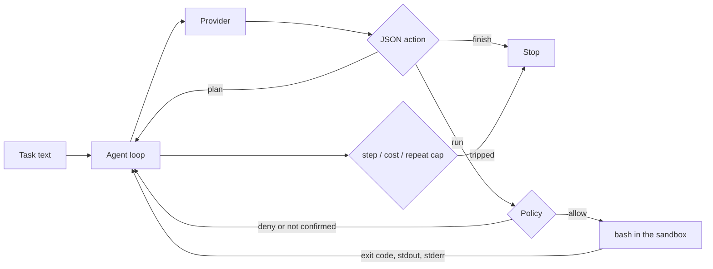

# terminal-agent

A terminal agent that plans a shell command, runs it, reads the exit code and output, and retries. The working directory is a sandbox directory, commands go through an allow/deny/confirm policy, and the loop stops on a timeout, a step cap, or a cost cap. Every step is written to a JSONL action log.

The built-in task suite runs with a scripted mock provider. No API key is required. The numbers below are from that mock. They are not a language-model score and not a [Terminal-Bench](https://github.com/harbor-framework/terminal-bench) score.

## What it is
- `terminal_agent/agent.py` — the loop. The model must reply with one JSON object: `plan`, `run`, or `finish`. A failing command's stdout and stderr are sent back as data. The same failing command string stops the run after 3 times.
- `terminal_agent/policy.py` — `allow`, `deny`, or `confirm` before bash starts. Deny wins over confirm. An allowlist of executables is on by default.
- `terminal_agent/sandbox.py` — `bash` with cwd, `HOME`, and `TMPDIR` set to the working directory. The parent environment is not copied. A timeout sends `SIGKILL` to the child process group.
- `terminal_agent/providers.py` — `ScriptedProvider` (replay, not a model), `OpenAICompatibleProvider` (`POST {base}/chat/completions`), and `OllamaProvider` (that client pointed at `http://127.0.0.1:11434/v1`, no API key).
- `terminal_agent/suite.py` — 13 tasks with setup and an independent scorer. The script does not get to mark itself passed.
- `terminal_agent/cli.py` — `run`, `suite`, and `decide`.

## Why
A loop that can run shell commands needs a place to stop. One bad edit should be visible in the next command's output, and a refused command should not run. The caps are there so a confused model cannot keep calling the provider. The policy is a parser in front of bash. It is not a container.

## Architecture


## How it works
| Concern | Behavior |
|---|---|
| Reply format | One JSON object. Anything else is a parse failure. Two parse failures stop the run. |
| Failed command | Exit code, stdout, and stderr go back to the model, wrapped as data. The model is told to change the command. |
| Repeat | The same command string, failing, stops the run on the 3rd failure. |
| Allowlist | Default executables are listed in `policy.py`. Anything else is denied. `--allow-any` skips only the allowlist. |
| Deny | Fork bomb, `sudo`, `mkfs`, `dd`, shutdown, pipe-to-shell, `setsid`/`nohup`, host admin tools, `rm` that mentions `/`, `~`, or `$HOME`, paths outside the sandbox, command substitution, shell wrappers (`bash`, `env`, `eval`, …), `find -exec`/`-delete`. |
| Confirm | `rm` of a local file, `mv`, `chmod`, `git push`/`reset`/`clean`, `kill`, `curl`/`wget`/`ssh`, package installs. `--confirm ask` prompts; a non-TTY refuses. `--confirm deny` refuses. `--confirm allow` runs it. |
| Timeout | Default 30s. The process group is killed. Exit code 124. |
| Cost | Before each call, spent + worst case (`max_completion_tokens` at the illustrative rate) is compared to `--max-usd` (default 0.50). The request sends that `max_tokens` value. Prices are illustrative: USD per 1M tokens, in 0.25, out 1.25, for `mock` and for any other model name. Not a vendor price. |
| Secrets | `OPENAI_API_KEY` and the rest of the parent environment are not passed to the child. The key is read from the named env var and sent only as an `Authorization` header. It is not an argv flag. |
| Bytecode | `PYTHONDONTWRITEBYTECODE=1`. A same-second edit that does not change the file size (`return a - b` vs `return a + b`) would otherwise be hidden by a stale `.pyc`. |
| Log | JSONL. One object per plan, policy decision, command, parse error, and stop. |

## Results
### Built-in suite — MOCK, scripted provider
Run: `python3 bench/run_suite.py`. Raw output: [`results/suite.json`](results/suite.json).

13/13 passed. Provider: `scripted-mock`. Label: `MOCK`. This provider replays a command list written for each task. It does not read the error and decide. The loop still executes the commands, including the ones that fail on purpose, and the scorer checks the directory afterward.

Recorded run: 2026-11-09T21:50:06Z, Python 3.12.3, `Linux-6.12.113+-x86_64-with-glibc2.39`. Wall time 0.7335s. Illustrative prices, USD per 1M tokens: in 0.25, out 1.25. Sum of the `spent_usd` column: 0.00588025. That is not a bill.

| Task | Result | Steps | Commands | Exit codes | Illustrative USD | Seconds |
|---|---|---|---|---|---|---|
| write_hello | pass | 3 | 1 | 0 | 0.00023 | 0.0024 |
| fix_failing_test | pass | 6 | 4 | 1 0 0 0 | 0.00090875 | 0.4816 |
| setup_project | pass | 7 | 5 | 0 0 0 0 0 | 0.00090325 | 0.0450 |
| parse_logs | pass | 3 | 1 | 0 | 0.0002555 | 0.0032 |
| csv_sum | pass | 3 | 1 | 0 | 0.0002955 | 0.0193 |
| fix_json | pass | 3 | 1 | 0 | 0.0002805 | 0.0192 |
| extract_ips | pass | 3 | 1 | 0 | 0.0003195 | 0.0182 |
| failing_import | pass | 5 | 3 | 1 0 0 | 0.0006025 | 0.0469 |
| count_py_files | pass | 3 | 1 | 0 | 0.00027825 | 0.0192 |
| copy_baks | pass | 3 | 1 | 0 | 0.000296 | 0.0211 |
| makefile_hello | pass | 4 | 2 | 0 0 | 0.0003805 | 0.0241 |
| git_commit | pass | 6 | 4 | 0 0 0 0 | 0.00080075 | 0.0137 |
| word_freq | pass | 3 | 1 | 0 | 0.00032925 | 0.0184 |

How to read it:
- `fix_failing_test` runs pytest (exit 1), reads `mathx.py` (exit 0), rewrites `add` to return a sum (exit 0), runs pytest again (exit 0). The scorer runs pytest itself and checks that `test_mathx.py` was not edited.
- `failing_import` runs `python3 main.py` (exit 1), writes `util.py` (exit 0), runs `main.py` again (exit 0). The scorer checks stdout is `OK!` and that `main.py` was not edited.
- The other tasks are checked the same way: file contents, a sum, parsed JSON, a git commit, `make hello`. Passing means those checks passed on this machine for these scripts.
- CI re-runs the suite and compares pass/fail to `results/suite.json`. It does not compare the seconds.

A separate unit test, not this table, checks that a scripted fail-then-fix run puts `ZeroDivisionError` into the next model request. That is the loop. The suite scripts do not use that text; they are fixed in advance.

## Terminal-Bench
[Terminal-Bench](https://github.com/harbor-framework/terminal-bench) ([tbench.ai](https://www.tbench.ai/)) is the benchmark for agents doing work in a terminal. The dataset is on the [Harbor Hub](https://hub.harborframework.com/datasets/terminal-bench/terminal-bench). Custom agents are described in the [Harbor docs](https://docs.harborframework.com/agents/custom-agents).

This repository has no Terminal-Bench run and no leaderboard rank. The table above is the built-in suite on a mock.

Harbor is not a dependency here, and CI does not install it. `examples/harbor_agent.py` is a sketch of the installed-agent shape from those docs: Harbor would install this CLI inside the task container and run it there. The file has not been executed. The container would be Harbor's sandbox; this policy would still apply inside it and may refuse commands a task expects. That has not been measured.

```bash
uv tool install harbor
# only after harbor is installed and the sketch can be imported:
harbor run -d terminal-bench/terminal-bench \
  -a examples.harbor_agent:TerminalAgent \
  -m openai/your-model
```

Read the current Harbor docs before changing that command. Submitting a leaderboard score is the benchmark's process, not something this repo does.

## Tests
87 tests (`pytest`): policy allow/deny/confirm (including `rm -rf /`, pipe-to-shell, path escape, command substitution), sandbox cwd/`HOME`/timeout/truncation/secret stripping, JSON parsing, the self-debug loop, step and budget caps, repeat-command stop, confirm allow vs deny, the action log, OpenAI-compatible and Ollama request shape against a local fake server (no API key), all 13 suite tasks, and the CLI.

```
$ python3 -m pytest -q
........................................................................ [ 82%]
...............                                                          [100%]
87 passed in 4.04s
```

## Run it
```bash
pip install -r requirements.txt
python3 -m pytest -q
python3 bench/run_suite.py
python3 -m terminal_agent run "Create hello.txt" \
  --provider mock \
  --script examples/write_hello.json \
  --workdir /tmp/terminal-agent-demo \
  --confirm deny
python3 -m terminal_agent decide "rm -rf /"    # deny, exit 2
```

`run` with no `--provider` expects `OPENAI_API_KEY` and refuses to call out if it is missing. Ollama, if you already have it running:

```bash
python3 -m terminal_agent run "Create hello.txt containing the word hello" \
  --provider ollama --model llama3.2 --workdir ./agent-work --confirm ask
```

An OpenAI-compatible server uses `--provider openai --base-url http://host:port/v1 --model name`. The key is taken from `--api-key-env` (default `OPENAI_API_KEY`). `finish` on the CLI means the model stopped. It does not mean a scorer checked the directory. Only `suite` scores.

`pip install -e .` installs the `terminal-agent` command. Runtime dependencies: the Python standard library, plus `bash`. The suite also uses `pytest`, `git`, and `make`.

## Limits
- The sandbox is a directory, a cleaned environment, and a command parser. It is not a container, a user namespace, or seccomp. `python3 -c` can still do things the parser does not see if the path is built at runtime (`chr(47)` and similar). Quoted absolute paths and whole-token paths are checked. Obfuscated ones are not.
- `sed` and `awk` can start other programs. They are on the allowlist. That is a hole.
- `--confirm allow` runs `rm keep.txt`. It does not bypass a deny.
- The preflight uses an estimate of input tokens (about 4 characters each) plus `max_completion_tokens`. The provider's reported usage is what gets added to spent. A server that ignores `max_tokens` can cost more than the worst case that was priced. The illustrative rate is not the model's price.
- The mock does not solve tasks. If you pass `--provider mock` you must pass `--script`.
- Ollama and OpenAI request shapes were tested against a local HTTP server in-process. No live Ollama and no live OpenAI account were called for the numbers in this file.
- No network namespace. `curl` is confirmation-gated, not impossible.
- One run, one process, one directory. No shared budget across machines.
- The Harbor sketch has not been run. Do not quote this repo as a Terminal-Bench result.

## Stack
Python 3.11+ · standard library · bash · pytest · git and make for the suite

## License
MIT
